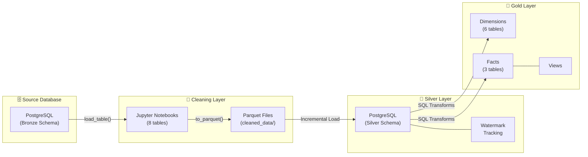
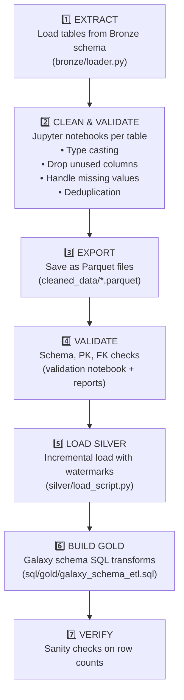

<p align="center">
  
  
  
  
  
  
</p>

<h1 align="center">🏗️ DEPI E-Commerce Data Warehouse</h1>

<p align="center">
  <b>An end-to-end ETL pipeline that extracts, cleans, validates, and models e-commerce data through a Bronze → Silver → Gold medallion architecture into a star/galaxy schema data warehouse.</b>
</p>

<p align="center">
  <a href="#-overview">Overview</a> •
  <a href="#-key-features">Features</a> •
  <a href="#-architecture">Architecture</a> •
  <a href="#-data-pipeline-workflow">Pipeline</a> •
  <a href="#-database-architecture">Database</a> •
  <a href="#-data-quality--validation">Validation</a> •
  <a href="#-getting-started">Setup</a> •
  <a href="#-running-the-pipeline">Run</a> •
  <a href="#-analytical-use-cases">Analytics</a> •
  <a href="#-roadmap">Roadmap</a>
</p>

---

## 📋 Overview

This project builds a **data warehouse** for a fictional e-commerce platform as part of the **DEPI (Digital Egypt Pioneers Initiative)** program. It processes **3.4M+ records** across 9 tables through a layered medallion architecture, transforming raw operational data into an analytics-ready **galaxy schema** (multi-fact star schema).

### Objectives

- Ingest raw data from a source PostgreSQL database (Bronze layer)
- Clean and standardize data with documented transformations (Notebooks → Parquet)
- Load cleaned data incrementally into a Silver schema with watermark tracking
- Transform Silver tables into a dimensional model (Gold layer) with 3 fact tables and 6 dimension tables
- Validate data quality at every layer (schema, PK, FK, missing values)
- Maintain a reproducible, testable, and well-structured codebase

---

## ✨ Key Features

| Feature | Description |
|---------|-------------|
| **Medallion Architecture** | Bronze → Silver → Gold layered data processing |
| **Incremental Loading** | Watermark-based loading ensures only new records are processed |
| **Galaxy Schema** | 3 fact tables + 6 dimensions supporting sales, inventory, and event analytics |
| **Data Quality Framework** | Automated validation for schemas, primary keys, foreign keys, and missing values |
| **Parquet Intermediate Storage** | Cleaned data stored as compressed Parquet files between layers |
| **Reusable Cleaning Library** | Python module with type-checking, duplicate detection, and validity checks |
| **Transactional Loads** | Data and watermark updates happen atomically in a single transaction |
| **Unit Tests** | 60 pytest tests covering cleaning functions, DB connection, and ETL loaders |

---

## 🏛️ Architecture



---

## 🔄 Data Pipeline Workflow



---

## 📊 Dataset Overview

| Table | Rows | Columns | Description |
|-------|-----:|--------:|-------------|
| `events` | 2,420,738 | 14 | User browsing and interaction events |
| `inventory_items` | 487,901 | 12 | Product inventory tracking |
| `order_items` | 180,952 | 7 | Individual items within orders |
| `orders` | 124,923 | 8 | Customer orders with status tracking |
| `users` | 100,000 | 12 | Customer profiles and demographics |
| `customer_activity` | 79,894 | 4 | Derived: first/last order dates per user |
| `products` | 29,120 | 8 | Product catalog |
| `customer_reviews` | 11,266 | 9 | Product reviews and ratings |
| `distribution_centers` | 10 | 2 | Warehouse locations |

> **Total: ~3.4 million cleaned records**

---

## 🗄️ Database Architecture

### Medallion Layers

```
┌──────────────────────────────────────────────────────────────────┐
│  BRONZE (Source)          Raw data, ingested as-is               │
│  ─────────────────────────────────────────────────────────────── │
│  SILVER (Cleaned)         Cleaned, typed, deduplicated           │
│                           Incremental loading with watermarks    │
│  ─────────────────────────────────────────────────────────────── │
│  GOLD (Modeled)           Galaxy schema: 3 facts + 6 dimensions │
│                           Analytics-ready                        │
└──────────────────────────────────────────────────────────────────┘
```

### Gold Layer — Galaxy Schema

The Gold layer implements a **galaxy schema** (multiple fact tables sharing conformed dimensions):

**Dimension Tables:**

| Dimension | Key | Description |
|-----------|-----|-------------|
| `dim_date` | `date_key` | Calendar dimension generated from data range |
| `dim_user` | `user_key` | Customer demographics with age groups |
| `dim_product` | `product_key` | Product catalog with pricing |
| `dim_location` | `location_key` | Geographic dimension (city, state, country) |
| `dim_distribution_center` | `dc_key` | Warehouse locations |
| `dim_event_profile` | `event_profile_key` | Event type × browser × traffic source |

**Fact Tables:**

| Fact | Grain | Measures |
|------|-------|----------|
| `fact_sales` | One row per order item | `sale_price`, `cost`, `profit` |
| `fact_inventory` | One row per inventory item | `cost`, `available`, `is_sold` |
| `fact_events` | One row per user event | `event_ts`, `sequence_number` |

**View:**

| View | Description |
|------|-------------|
| `vw_customer_activity` | First/last order date and recency per customer |

---

## ✅ Data Quality & Validation

Validation is performed via a dedicated notebook (`validation/01_schema_validation.ipynb`) that generates CSV reports:

| Check | Report File | Result |
|-------|-------------|--------|
| **Schema Validation** | `schema_report.csv` | 6/7 tables valid |
| **Primary Key Integrity** | `primary_key_report.csv` | All 7 tables — 0 nulls, 0 duplicates ✅ |
| **Foreign Key Integrity** | `foreign_key_report.csv` | All 9 relationships — 0 orphans ✅ |
| **Missing Values** | `missing_values_report.csv` | Documented per column with percentages |

The `cleaning/check.py` module provides reusable validation functions:
- `check_dataframe()` — Type guard for DataFrame inputs
- `numerical_data()` / `categorical_data()` — Column type selectors
- `check_missing_values()` — Null counts and percentages
- `check_duplicates()` — Duplicate row detection
- `numeric_validity_checks()` — Positive-value constraints
- `categorical_validity_checks()` — Empty string detection

---

## 📁 Repository Structure

```
depi-project/
├── 📂 src/depi_project/           # Main Python package
│   ├── cleaning/
│   │   └── check.py               # Data validation & cleaning functions
│   ├── dbconnection/
│   │   └── connection.py           # SQLAlchemy engine factory (PostgreSQL)
│   └── etl/
│       ├── bronze/
│       │   └── loader.py           # Load tables from Bronze schema
│       ├── silver/
│       │   └── load_script.py      # Incremental parquet → Silver loader
│       └── gold/                   # (Gold transforms handled via SQL)
│
├── 📂 notebooks/                   # Data cleaning notebooks (1 per table)
│   ├── distribution_centers.ipynb
│   ├── events.ipynb
│   ├── inventory_items.ipynb
│   ├── order_items.ipynb
│   ├── orders.ipynb
│   ├── products.ipynb
│   ├── users.ipynb
│   └── user_info.ipynb             # Derives customer_activity
│
├── 📂 sql/
│   ├── silver/create/
│   │   └── schema.sql              # Silver table DDL
│   └── gold/
│       └── galaxy_schema_etl.sql   # Full galaxy schema: DDL + INSERT
│
├── 📂 validation/
│   ├── 01_schema_validation.ipynb  # Validation checks notebook
│   └── reports/                    # Generated CSV reports
│       ├── schema_report.csv
│       ├── primary_key_report.csv
│       ├── foreign_key_report.csv
│       └── missing_values_report.csv
│
├── 📂 cleaned_data/                # Parquet outputs (gitignored)
├── 📂 tests/                       # Unit tests (60 tests)
│   ├── conftest.py
│   ├── test_cleaning.py
│   ├── test_connection.py
│   ├── test_bronze_loader.py
│   └── test_silver_loader.py
│
├── .env.example                    # Environment variables template
├── pyproject.toml                  # Project config & dependencies
└── uv.lock                        # Locked dependency versions
```

---

## 🛠️ Tech Stack

| Category | Technology |
|----------|------------|
| **Language** | Python 3.13 |
| **Database** | PostgreSQL |
| **ORM / DB Toolkit** | SQLAlchemy 2.x |
| **DB Driver** | psycopg2 |
| **Data Processing** | Pandas, PyArrow |
| **File Format** | Apache Parquet |
| **Analytics Engine** | DuckDB (available for ad-hoc queries) |
| **Package Manager** | uv |
| **Testing** | pytest |
| **Notebooks** | Jupyter |

---

## 🚀 Getting Started

### Prerequisites

- **Python 3.13+**
- **PostgreSQL** database with Bronze schema populated
- **[uv](https://docs.astral.sh/uv/)** package manager

### Installation

```bash
# Clone the repository
git clone https://github.com/amretman77/depi-project.git
cd depi-project

# Install dependencies with uv
uv sync
```

### Environment Variables

Copy the example file and fill in your database credentials:

```bash
cp .env.example .env
```

```env
DB_HOST=localhost
DB_PORT=5432
DB_NAME=depi_db
DB_USER=your_username
DB_PASSWORD=your_password
```

---

## ▶️ Running the Pipeline

### 1. Clean Data (Notebooks)

Run each cleaning notebook in `notebooks/` to extract from Bronze, clean, and export to Parquet:

```bash
# Open Jupyter and run notebooks in order
jupyter notebook notebooks/
```

Each notebook:
- Loads a table from the Bronze schema using `load_table()`
- Applies cleaning transformations (type casting, column drops, null handling)
- Exports the result to `cleaned_data/<table>.parquet`

### 2. Validate Data

Run the validation notebook to generate quality reports:

```bash
jupyter notebook validation/01_schema_validation.ipynb
```

Reports are saved to `validation/reports/`.

### 3. Load Silver Layer

Run the incremental loader to push cleaned Parquet files into the Silver schema:

```bash
uv run python -m depi_project.etl.silver.load_script
```

This script:
- Reads each Parquet file in `cleaned_data/`
- Compares against watermarks to find new records
- Loads only new records into Silver tables
- Updates watermarks atomically

### 4. Build Gold Layer

Execute the galaxy schema SQL to build dimensions and facts:

```bash
psql -h $DB_HOST -U $DB_USER -d $DB_NAME -f sql/gold/galaxy_schema_etl.sql
```

### 5. Run Tests

```bash
uv run pytest tests/ -v
```

```
======================== 60 passed in 0.27s ========================
```

---

## 🔍 Analytical Use Cases

Once the Gold layer is built, you can run analytical queries like:

**Revenue by Product Category:**
```sql
SELECT dp.category,
       SUM(fs.sale_price)  AS total_revenue,
       SUM(fs.profit)      AS total_profit,
       COUNT(*)             AS items_sold
FROM   gold.fact_sales fs
JOIN   gold.dim_product dp ON dp.product_key = fs.product_key
GROUP  BY dp.category
ORDER  BY total_revenue DESC;
```

**Monthly Sales Trend:**
```sql
SELECT dd.year, dd.month, dd.month_name,
       SUM(fs.sale_price)  AS revenue,
       COUNT(DISTINCT fs.order_id) AS orders
FROM   gold.fact_sales fs
JOIN   gold.dim_date dd ON dd.date_key = fs.order_date_key
GROUP  BY dd.year, dd.month, dd.month_name
ORDER  BY dd.year, dd.month;
```

**Customer Segmentation by Recency:**
```sql
SELECT CASE
         WHEN days_since_last_order <= 30  THEN 'Active'
         WHEN days_since_last_order <= 90  THEN 'Warm'
         WHEN days_since_last_order <= 180 THEN 'At Risk'
         ELSE 'Churned'
       END AS segment,
       COUNT(*) AS customers
FROM   gold.vw_customer_activity
GROUP  BY segment
ORDER  BY customers DESC;
```

**Top Traffic Sources by Conversion:**
```sql
SELECT dep.traffic_source,
       COUNT(*)                                    AS total_events,
       COUNT(CASE WHEN dep.event_type = 'purchase' THEN 1 END) AS purchases
FROM   gold.fact_events fe
JOIN   gold.dim_event_profile dep ON dep.event_profile_key = fe.event_profile_key
GROUP  BY dep.traffic_source
ORDER  BY purchases DESC;
```

---

## 🗺️ Roadmap

- [ ] **Airflow Orchestration** — Automate the full pipeline with a DAG (cleaning notebooks need conversion to callable scripts first)
- [ ] **Convert Notebooks to Scripts** — Refactor cleaning notebooks into Python modules for automation
- [ ] **Incremental Gold Layer** — Replace full rebuild with merge/upsert patterns
- [ ] **Data Quality Gates** — Fail the pipeline automatically on validation errors
- [ ] **CI/CD Integration** — Run tests automatically on push
- [ ] **Dashboard Layer** — Connect BI tools (Metabase / Power BI) to Gold schema

---

## 👤 Author

**Amr Etman**

- GitHub: [@amretman77](https://github.com/amretman77)
- Email: amretman12132@gmail.com

Built as part of the **Digital Egypt Pioneers Initiative (DEPI)** — Data Engineering Track.

---

## 🤝 Contributing

Contributions are welcome! Please feel free to submit a pull request.

1. Fork the repository
2. Create a feature branch (`git checkout -b feature/my-feature`)
3. Commit your changes (`git commit -m 'Add my feature'`)
4. Push to the branch (`git push origin feature/my-feature`)
5. Open a Pull Request

---

<p align="center">
  <sub>⭐ If you found this project helpful, please consider giving it a star!</sub>
</p>
